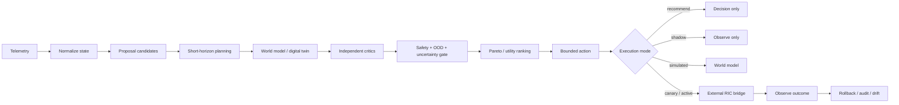
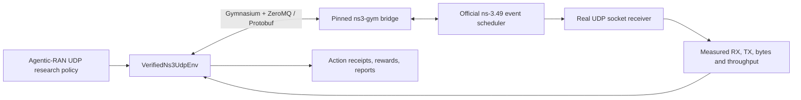

# Agentic-RAN

**Safety-governed agentic intelligence for Open RAN—built for reproducible research, measurable evidence, and controlled execution.**

[](https://github.com/vtavakkoli/Agentic-RAN/actions/workflows/ci.yml)
[](https://github.com/vtavakkoli/Agentic-RAN/actions/workflows/native-verified-ns3-gym.yml)
[](https://www.python.org/)
[](LICENSE)
[](#production-limitations)

[](https://scikit-learn.org/)
[](https://pytorch.org/)
[](https://gymnasium.farama.org/)
[](https://www.nsnam.org/)
[](docs/DOCKER_MODERN_NS3_GYM.md)
[](https://zeromq.org/)
[](https://protobuf.dev/)
[](https://fastapi.tiangolo.com/)
[](compose.yaml)
[](https://pytest.org/)

Agentic-RAN is a **modular, safety-first research and evaluation platform** for intelligent **Open Radio Access Networks (O-RAN)**. It combines KPI-aware machine-learning proposals, short-horizon planning, digital twins, independent critics, uncertainty/OOD assessment, constrained action selection, rollback, and audit trails. Its evaluation stack separates **public network measurements**, **reproducible offline learning**, **action-dependent toy experiments**, and a **verified real ns-3 UDP simulation backend**.

> **Machine learning proposes. World models predict. Independent critics verify. Deterministic safety logic retains execution authority.**

An LLM, when enabled for explanation, **does not sit in the actuation control path**.

> [!IMPORTANT]
> **Research evidence is not production authorization.** The ns-3.49 integration has passed a real, compiled **UDP closed-loop simulation**; it does **not** currently validate 5G NR PHY, O-RAN E2, COMMAG PRB/scheduler execution, or real-network gains. Missing physical capabilities fail explicitly rather than returning synthetic results.

## Explore the project

| Start here | Technical deep dives |
|---|---|
| [Why Agentic-RAN](#why-this-repository-is-different) | [Control architecture](#agentic-control-cycle) |
| [Real-data benchmark](#one-command-real-data-benchmark) | [COMMAG offline RL](#commag-offline-rl-benchmark) |
| [Verified native ns-3](#verified-native-ns-3-gymnasium-integration) | [Safety and trust](#safety-and-trustworthy-control) |
| [Execution modes](#execution-modes) | [Research methodology](#research-positioning) |
| [Local Python setup](#local-python-quick-start) | [REST API](#existing-rest-api) |
| [Project structure](#repository-structure) | [License](#license) · [Cite](#citation) |

## System at a glance

| Layer | Purpose | Technology / evidence |
|---|---|---|
| **Data & telemetry** | Normalize measured network KPIs; distinguish measured from derived features | pandas, NumPy, public Zenodo datasets, COMMAG, srsRAN shadow adapters |
| **Intelligence** | Generate, score, and compare bounded controller proposals | scikit-learn, offline Fitted-Q, optional PyTorch PPO/WSP |
| **Reasoning & trust** | Forecast, simulate, gate uncertainty/OOD, enforce constraints and audit | digital twins, independent critics, deterministic safety logic |
| **Interaction** | Serve decisions and integrate controlled external RAN adapters | FastAPI, configurable shadow/canary boundaries |
| **Simulation** | Compare policies in explicit action spaces; verify native network exchange | Gymnasium toy backends **and separately** native ns-3.49 + ZeroMQ/Protobuf |
| **Reproducibility** | Pin data/code, test behavior, and create inspectable reports | Docker Compose, pytest, GitHub Actions, checksum manifests |

### What has actually been verified?

| Evidence level | What it demonstrates | What it does **not** demonstrate |
|---|---|---|
| **Real public measurements** | Observed network KPIs, source provenance, held-out offline evaluation | Live network actuation or causal production gains |
| **Action-dependent toy Gymnasium** | Controller decisions affect an explicit simulated state and reward | True 5G NR PHY, PRB scheduling, or E2AP |
| **Native ns-3.49 / Python 3.13** | Real ns-3 UDP packets, actions, observations, rewards, repeatable episodes, resource cleanup | COMMAG-equivalent PRB/scheduler or handover performance |
| **External physical RAN control** | Requires separately supplied, validated model/action mapping and operator gates | **Not claimed as completed** by the packaged UDP simulator |

## Fastest ways to run

**Full real-data evidence pipeline** (see [details](#one-command-real-data-benchmark)):

```bash
docker compose --profile test up --build --abort-on-container-exit --exit-code-from test test
```

**Real native ns-3 UDP experiment** (a separate, opt-in image—not the production container):

```bash
docker compose --progress plain -f docker-compose.ran-gym.yml --profile native build ran-gym-modern-ns3-smoke
docker compose -f docker-compose.ran-gym.yml --profile native run --rm ran-gym-modern-ns3-smoke
```

The native run writes `results/modern-ns3/real_closed_loop.json`. It compiles pinned **ns-3.49/C++23**, installs the independently maintained [vtavakkoli/ns3-gym](https://github.com/vtavakkoli/ns3-gym) package under **Python 3.13**, and verifies multiple real UDP episodes. See the [build and test guide](docs/DOCKER_MODERN_NS3_GYM.md).

**Experiment boundaries:** These workflows are intentionally independent. Running a successful UDP simulator does not convert a toy or offline scheduler result into a physical NR claim.

## Why this repository is different

Agentic-RAN is designed around three separate evidence layers:

1. **Deterministic bootstrap data** for reproducible development and unit tests.
2. **Public real-world 5G measurements** for external shadow realism and model comparison.
3. **Live RIC/gNB telemetry** for laboratory shadow, canary and eventual controlled experimentation.

The repository never labels public-data proxy targets as operator ground truth and never labels an HTTP bridge as E2AP.

## Agentic control cycle



## IEEE Access reproducible research campaign

The dedicated [end-to-end research workflow](docs/IEEE_ACCESS_END_TO_END.md) runs
Docker-based **training, validation, held-out testing, full COMMAG offline
evaluation, PULSE shadow replay, and real ns-3.49 UDP integration**, then
produces an HTML/Markdown scientific audit, paired-comparison tables, a
publication figure, and machine-readable evidence checksums.

**Windows PowerShell:**

```powershell
powershell -ExecutionPolicy Bypass -File .\scripts\run_ieee_access_complete.ps1 -Preset research
```

For a quick **functional-only** smoke test (not IEEE Access performance
evidence), add `-Preset smoke -SkipOffline -SkipNative`.

The full workflow **does not** present toy rewards or UDP packets as observed
NR PRB/scheduler interventions. Manuscript readiness remains subject to a
separately validated real NR simulator, novelty and independent author review.

## Verified native ns-3 Gymnasium integration

**Real C++ simulation, not an interface-only mock.** A dedicated Docker target builds the official **ns-3.49** release (`418210e8914e9f6bcb5cddbcc94a2cecb7853b68`) and the independently verified [vtavakkoli/ns3-gym](https://github.com/vtavakkoli/ns3-gym) bridge (pinned commit `21e68565a6beaf13589fd19778b5332f4d0b29e0`).

[](https://github.com/vtavakkoli/Agentic-RAN/actions/workflows/native-verified-ns3-gym.yml)
[](https://github.com/vtavakkoli/ns3-gym/actions/workflows/native-ns3.yml)



The verified example controls the number of **256-byte UDP packets** sent between two ns-3 nodes, and returns receiver-derived packet counts and throughput. The adapter checks that the simulated network transmitted the **requested action** and fails on incompatible actions. Repeated seeded episodes and explicit fallback/error paths are tested.

**Verified results:** [successful post-merge native workflow](https://github.com/vtavakkoli/Agentic-RAN/actions/runs/45205513828) · [3-episode, 15-step JSON evidence](https://github.com/vtavakkoli/Agentic-RAN/actions/runs/45205513828/artifacts/14832874620). One measured episode delivered **9 of 9 transmitted UDP packets (2,304 bytes)**. All **7 standard CI jobs** also passed on [the same merged revision](https://github.com/vtavakkoli/Agentic-RAN/actions/runs/45205513872).

**Strict limitation:** The UDP action is **not** a scheduler, slice, PRB or O-RAN E2 action. The frozen COMMAG controller cannot be evaluated by relabelling that example. Native publication-quality PRB control requires a new validated RAN scenario and compatible action/observation mapper.

**Instructions:** [docs/DOCKER_MODERN_NS3_GYM.md](docs/DOCKER_MODERN_NS3_GYM.md) · [native adapter source](agentic_ran/research_modern_ns3_adapter.py) · [native integration tests](tests/test_modern_ns3_integration.py).

## One-command real-data benchmark

Docker Compose prefers `compose.yaml`, which defines the complete evidence pipeline:

```bash
docker compose --profile test up --build --abort-on-container-exit --exit-code-from test test
```

The dependency chain is:

```text
prepare-data
   ↓
model-selection
   ↓
report
   ↓
test
```

When it finishes, open:

```text
results/report.html
```

The same stages can be run separately:

```bash
docker compose up --build prepare-data
docker compose up --build model-selection
docker compose up --build report
```

## COMMAG offline-RL benchmark

The optional `commag` profile uses the public Colosseum O-RAN COMMAG traces without cloning or redistributing the approximately 1.2 GB upstream repository. It downloads a commit-pinned representative core, aggregates 250 ms telemetry to one-second transitions, compresses the result and trains Fitted Q Iteration on `exp1`. All reported test metrics come from disjoint `exp2` episodes.

```bash
LOCAL_UID=$(id -u) LOCAL_GID=$(id -g) \
  docker compose --profile commag up --build commag-test
```

The dependency chain is:

```text
commag-prepare
      ↓
commag-train
      ↓
commag-test
```

Generated evidence:

```text
data/prepared/commag/commag_transitions.csv.gz
data/prepared/commag/commag_manifest.json
artifacts/commag_fitted_q.joblib
results/commag_benchmark.json
results/commag_report.html
```

The discrete action combines scheduler and PRB allocation, for example `proportional_fair:prb=8`. The benchmark preserves only actions observed for each slice and reports reward-model error, Bellman residual, logged-action agreement and clearly labelled direct-method estimates.

PPO is deliberately not retrained from fixed CSV logs: PPO is on-policy and requires an interactive environment. The original COMMAG PPO artifacts remain upstream; Agentic-RAN uses Fitted-Q because it is an appropriate offline baseline. See `docs/COMMAG.md` for the protocol and limitations.

**Experimental PPO + weight-space editing:** For an *interactive, action-dependent toy* three-slice benchmark, use the optional `.[ppo]` dependency and `python -m agentic_ran.research_ppo_wsp`. It trains clipped PPO, then tests validation-selected sparse edits of its actor output weights against frozen PPO, random edits and PULSE-RAN on paired, untouched test seeds. Read [method and limitations](docs/PPO_WEIGHT_SPACE.md). This is not physical NR validation; superiority is not assumed.

### What `prepare-data` does

The source catalog is `configs/data_sources.yaml`. The default profile downloads public 5G measurement datasets from their original Zenodo records, verifies the published MD5 checksum, normalizes heterogeneous Excel tables and writes compressed outputs:

```text
data/
├── bootstrap/ran_policy_sample.csv
├── raw/                              # downloaded originals; local only
└── prepared/
    ├── real_measurements.csv.gz      # normalized measured KPIs
    ├── real_policy_eval.csv.gz       # complete model schema + provenance columns
    └── provenance.json               # DOI/checksum/source statistics
```

The current catalog includes:

- **Telenor/COMMECT 5G private-network forestry measurements** — RSRP, downlink/uplink throughput, latency and jitter; DOI `10.5281/zenodo.16919567`.
- **Glasgow 5G Dataset 2025** — signal strength, download/upload throughput and ping across multiple providers/devices; DOI `10.5281/zenodo.20465872`, CC BY 4.0.

Raw third-party files are not redistributed by this repository. The compressed prepared data is generated locally. See `docs/REAL_DATA.md` and `THIRD_PARTY_DATA.md`.

### Measured versus derived RAN inputs

Public measurement datasets do not expose every internal RAN counter used by the controller. Agentic-RAN therefore preserves explicit metadata on every prepared row:

- `measured_fields`
- `observed_model_features`
- `derived_model_features`
- `realism_score`

Missing internal fields are completed by transparent deterministic proxies in `agentic_ran/real_features.py`. The generated `policy_label` is the repository's expert-rule reference and **is not an operator action or production ground truth**.

## Production-oriented model selection

`agentic-ran select-model` compares four CPU-friendly policy proposers:

| Candidate | Purpose |
|---|---|
| HistGradientBoosting | nonlinear compact baseline |
| ExtraTrees | robust ensemble baseline |
| RandomForest | interpretable bagged-tree baseline |
| LogisticRegression | simple calibrated linear baseline |

The winner is not chosen by accuracy alone. The production score combines:

- **45%** synthetic hold-out macro-F1;
- **25%** real expert-reference macro-F1;
- **15%** prediction stability under KPI perturbation;
- **10%** probability calibration;
- **5%** single-observation inference latency.

The selected model is retrained with all bootstrap data plus a **capped** amount of real expert-referenced data, preventing proxy-labelled public data from dominating the training distribution.

## `results/report.html`

The report is a self-contained deployment-evidence artifact containing:

- dataset provenance, DOI, checksums and row counts;
- measured-feature coverage and realism score;
- all candidate models and their ranking metrics;
- selected model/version;
- real-data policy distribution, confidence, OOD and uncertainty;
- safe-selection and safety-override rates;
- deterministic guardrail results;
- synthetic end-to-end latency/throughput benchmark;
- readiness gates and an explicit final verdict.

Possible verdicts are:

- `NEEDS CALIBRATION`
- `RESEARCH-READY`
- `SHADOW-READY`

**`SHADOW-READY` is intentionally not `PRODUCTION-READY`.** Active control requires a calibrated RIC/gNB laboratory, authenticated transport, operator approval, rollback drills, long-duration shadow validation and independent safety/security review.

## Core platform capabilities

### Experimental action-dependent JAGC and physical BWP budgets

The original 14-PRB historical allocation proxy is no longer used as
a physical cell budget. The opt-in offline JAGC now requires an
NR-PHY-derived per-base-station carrier/BWP capacity manifest and
fails closed if it is missing. See
[physical BWP and action-dependent protocol](docs/PHYSICAL_CLOSED_LOOP_RESEARCH.md).

A separate closed-loop research runner uses a persistent external
ns-3/5G-LENA or Colosseum process, **executed randomized interventions**,
a frozen original Agentic-RAN comparator, and validation-only
supported-advantage learning. It explicitly projects the frozen
baseline's per-slice allocations onto the shared physical capacity.
The bundled ns-3 event-queue example is a **simplified discrete-event
demonstrator**, not 5G-LENA 5G NR PHY evidence or a Colosseum run.
The 10% target remains unproven.

### Agentic-RAN v3: Joint-Slice Advantage-Gated Control (research)

Enable the optional JAGC model for **actual prepared COMMAG recordings**
while preserving the original Agentic-RAN controller as the baseline:

~~~powershell
$env:AGENTIC_RAN_EVAL_JOINT_SLICE_ADVANTAGE = "1"
docker compose -f docker-compose.publication.yml up --build --force-recreate --exit-code-from publication-test publication-test
~~~

It aligns contemporaneous eMBB/mMTC/URLLC cells at each base
station and timestamp, uses training-only PRB-budget proxies, solves
the supported three-slice allocation with a multiple-choice knapsack,
and promotes only validation-supported estimated advantages. Outputs
are written to results/publication/research_joint_slice_*. The evaluation
is **offline independent direct-method estimation**, not observed
network intervention or evidence that a 10% improvement exists.
See [JAGC methods and output](docs/JOINT_SLICE_ADVANTAGE.md).

### PULSE-RAN: real COMMAG traces versus synthetic simulation

**Use the real-data workflow to analyze PULSE-RAN recommendations on
Colosseum COMMAG recordings:**

~~~powershell
git pull --ff-only
docker compose -f docker-compose.publication.yml up --build --force-recreate --exit-code-from pulse-commag-shadow pulse-commag-shadow
~~~

This runs the prepared COMMAG dataset shadow analysis and writes
results/pulse-commag/. It is **not** a PULSE actuation experiment,
does not start ns-3 or a new Colosseum run, and does not establish
counterfactual reward superiority. See
[the corrected real-data instructions](docs/PULSE_RAN_COMMAG.md).

### PULSE-RAN: priority-driven baseline in the action-dependent twin

**PULSE-RAN** (*Priority-driven URLLC and Load-Sensitive Engine*) is the
new name of our original queue-priority baseline. It first selects the
URLLC-favoring allocation when the URLLC queue exceeds 0.45, otherwise
an eMBB-favoring allocation when the eMBB queue exceeds 1.0, and
otherwise the balanced configuration. No thresholds or outcomes were
changed by the rename.

Compare PULSE-RAN to the existing Twin-CQL, distributional-CVaR,
CQL/CVaR hybrid and greedy policies using identical *simulated*
action-dependent episode seeds:

~~~bash
python -m agentic_ran.research_twin_study --seed 2028 --train-episodes 160 --validation-episodes 40 --test-episodes 60 --steps 24 --output results/pulse_ran_comparison.json
python -m agentic_ran.research_pulse_report --input results/pulse_ran_comparison.json
~~~

The JSON includes episode-paired comparisons to PULSE-RAN, validation
ranking across all controllers and realized per-slice SLA/utility
metrics; the neighboring `pulse_ran_comparison_episodes.csv` contains
per-episode observations. A separate `pulse_ran_gated` diagnostic
applies the learned twin's action-support and queue-risk restrictions
and is **not** the original method. The unshielded PULSE-RAN is not
necessarily deployment-safe; these tests are in a **constructed toy
simulator**, not live 5G/O-RAN evidence. See
[experimental methods](docs/TWIN_CQL_CVAR_RESULTS_2026.md).

### Planning and digital twin

- configurable multi-step counterfactual rollouts;
- `RANWorldModel` abstraction;
- transparent bounded surrogate model;
- trace-replay world model;
- external ns-3 / calibrated digital-twin adapters;
- world-model uncertainty carried into the decision.

### Safety and trustworthy control

- bounded transmit-power and PRB actions;
- independent SLA, energy, stability and uncertainty critics;
- telemetry age/completeness penalties;
- feature-envelope OOD detection;
- conservative balanced fallback;
- temporal policy dwell/churn guards;
- canary allow-list and control envelope;
- measured-outcome rollback evaluation.

### Intent-driven optimization

Built-in profiles include `balanced`, `urllc-strict`, `embb-capacity`, `mmtc-reliability` and `green-ran`. Each intent can define constraints, objective weights, risk tolerance and an energy budget. Safe non-dominated candidates are exposed through a Pareto front.

### Multi-cell intelligence

`MultiCellCoordinator` detects interference-sensitive conflicts across neighboring cells and penalizes locally attractive decisions that create network-level risk. It is a research baseline and must be calibrated before network-optimal claims.

### Forecasting and RL baselines

- persistence, EWMA, linear-trend and ensemble forecasting;
- Fitted Q Iteration for offline discrete-action learning;
- constrained RL wrapper with an explicit safety predicate.

RL remains a proposal/baseline source and cannot bypass the authoritative safety layer.

### Governance and MLOps

- SHA-256 hash-chained decision audit records;
- model artifact registry and hashes;
- drift monitoring;
- model-promotion gates;
- model/version metadata in every decision.

### O-RAN / srsRAN boundaries

Telemetry providers support synthetic observations, CSV replay, srsRAN JSON WebSocket metrics, decoded E2SM-KPM dictionaries and Prometheus projection. The control side includes a bounded E2SM-RC bridge abstraction and Near-RT xApp / Non-RT rApp orchestration primitives.

**Protocol boundary:** Agentic-RAN does not pretend that HTTP JSON is E2AP. ASN.1/E2AP/E2SM encoding and SCTP transport belong to a standards-capable O-RAN SC, FlexRIC or equivalent RIC/xApp binding. See `docs/ORAN_INTEGRATION.md`.

## Matched final-algorithm Gymnasium experiment (toy functional gate)

For an action-dependent, same-action-space check of **PPO, PPO with
weight-space edits, PULSE-RAN, Twin-CQL, distributional CVaR and
CQL/CVaR hybrid**, run:

```powershell
docker compose -f docker-compose.ran-gym.yml run --build --rm ran-gym-final-test
docker compose -f docker-compose.ran-gym.yml run --build --rm ran-gym-final-algorithms
```

The output is `results/ran-gym-final-algorithms/gym_final_summary.json`.
It includes held-out matched seeds, action-dependent rewards, SLA queue
proxies and paired statistics. This is an **interventional toy Gymnasium
evaluation, NOT native 5G-LENA/Colosseum execution**. The separate
[verified ns-3.49 Python 3.13 Gymnasium integration](docs/DOCKER_MODERN_NS3_GYM.md)
runs real two-node UDP packet-control experiments from the pinned
[vtavakkoli/ns3-gym](https://github.com/vtavakkoli/ns3-gym) repository.
**UDP packet counts are not COMMAG PRB/scheduler actions**; a separate
validated NR RAN backend and action mapper remain mandatory for
publication-level physical evaluation.
See [IEEE Access experimental audit](docs/IEEE_ACCESS_FINAL_ALGORITHMS_AUDIT.md)
before describing controller gains in a manuscript.

## Research-scale multi-training-seed RAN Gym experiment

For the most comprehensive **compatible-action** Gymnasium train/validate/test
campaign (10 independent training seeds, 40 held-out test seeds per training
run, six controllers and four traffic/channel scenarios) use:

```powershell
powershell -ExecutionPolicy Bypass -File .\scripts\run_ieee_access_gym_campaign.ps1 -FullOffline
```

The Docker implementation exports frozen protocol JSON, PPO/WSP checkpoints,
episode and step traces, aggregate paired statistics, scenario and training-run
tables, SHA-256 evidence manifest and a self-contained HTML report. It does not
equate toy Gymnasium results with physical NR PRB/scheduler actuation. See
[research-scale reproducibility and evidence limitations](docs/IEEE_ACCESS_MULTISEED_GYM_CAMPAIGN.md).

## Execution modes

| Mode | RAN change | Intended use |
|---|---:|---|
| `recommend` | No | API/research decision support |
| `shadow` | No | live telemetry evaluation |
| `simulated` | Twin only | closed-loop laboratory experiments |
| `canary` | allow-listed lab cells only | bounded isolated validation |
| `active` | external bridge | validated research environment only |

The default is **`recommend`**.

## Local Python quick start

```bash
python -m venv .venv
source .venv/bin/activate
python -m pip install -e ".[dev,oran]"

agentic-ran generate-data --output data/runtime/ran_policy_sample.csv
agentic-ran train --data data/runtime/ran_policy_sample.csv
agentic-ran serve --port 8080
```

Real-data commands are also available outside Docker:

```bash
agentic-ran prepare-real-data
agentic-ran select-model
agentic-ran production-report
```

## Existing REST API

```text
GET  /healthz
GET  /readyz
GET  /metrics
GET  /v1/policies
POST /v1/decisions
POST /v1/decisions/batch
```

## Live srsRAN shadow mode

```bash
agentic-ran xapp-shadow --url ws://127.0.0.1:8001 --steps 20 --intent balanced
```

Shadow mode records decisions without changing the RAN.

## Repository structure

```text
agentic_ran/
├── actuation.py          execution modes, bridge boundary, rollback
├── audit.py              tamper-evident audit
├── control_loop.py       observe → decide → act → verify
├── coordinator.py        multi-cell coordination
├── data_adapters.py      heterogeneous real-KPI normalization
├── data_sources.py       source catalog/download integrity
├── engine.py             planner, critics and selector
├── model_selection.py    multi-model production benchmark
├── production_report.py  results/report.html generator
├── real_data.py          real-data preparation orchestration
├── real_features.py      measured/derived feature completion
├── safety.py             OOD, uncertainty and temporal safety
├── telemetry.py          synthetic, replay, srsRAN, KPM, Prometheus
└── twin.py               surrogate/replay/external world models

configs/data_sources.yaml  public real-data catalog
compose.yaml               preferred real-data Docker workflow
docs/REAL_DATA.md          data semantics and limitations
results/report.html        generated readiness report
```

## Research positioning

**Publication-methodology caveat:** the latest evaluation code distinguishes
open-loop replay switching from disagreement with logged actions, adds sampled
state-conditional overlap analysis and component ablations. These checks
strengthen the offline evidence but are not live intervention validation.
See [the methodology audit](docs/METHODOLOGY_AUDIT.md) and
[the publication workflow](README.publication.md). Do not treat pre-audit
manuscript switching values as revised results.

The flagship question is not "which classifier predicts policy labels best?" It is:

> **Can a safety-governed agentic controller improve heterogeneous RAN utility while maintaining explicit SLA and safety constraints under disturbances, uncertainty and distribution shift?**

Recommended outcome metrics include SLA violation rate, safety rejection rate, rollback frequency, recovery time, throughput-demand satisfaction, latency, packet loss, energy/throughput trade-off, policy churn, OOD behavior, multi-cell utility and decision latency.

## Production limitations

Agentic-RAN is a **research platform**, not a certified mobile-network controller. Before production deployment, calibrate the world model and feature mappings using approved network data, verify the exact RIC/gNB release and service models, add authenticated control transport and external immutable audit, perform long-duration shadow and isolated canary validation, define operator approval/rollback procedures, and complete independent safety/security review.

## License

MIT License. Third-party datasets retain their original terms. See each source record in `configs/data_sources.yaml`.

## Citation

If Agentic-RAN supports academic work before a formal paper is published, cite the repository and the exact version or commit used. `CITATION.cff` is included.
